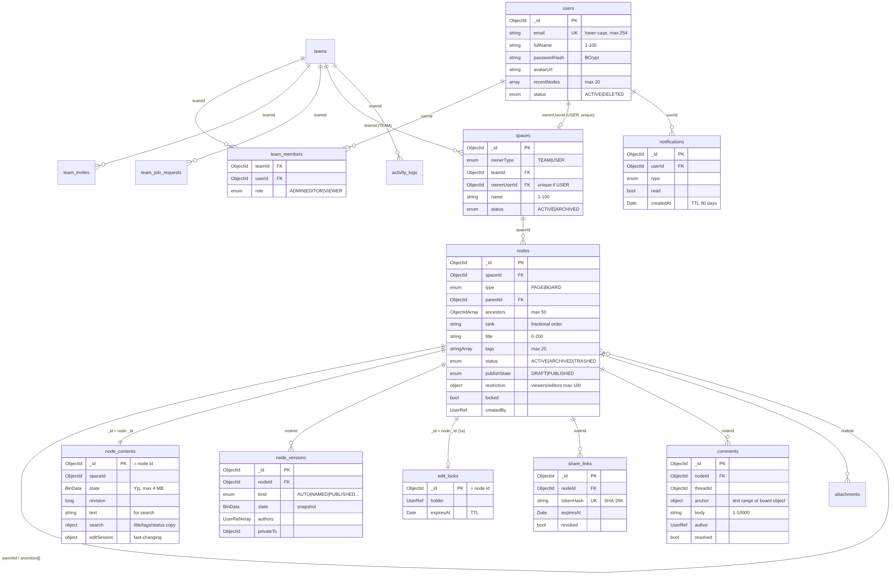
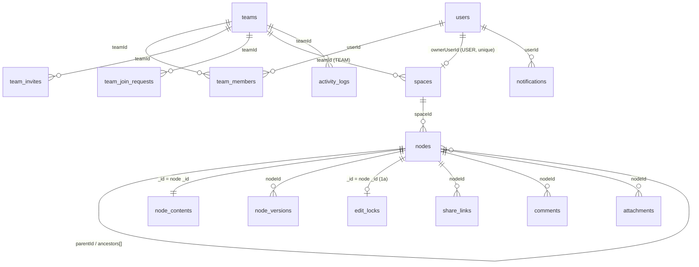

# Physical Schema: MongoDB (Releases 1a-2)

Date: 2026-11-09 · Status: APPROVED 2026-11-09
Implements: `Docs/specs/2026-11-09-domain-model-design.md` (approved) and ADRs 0001-0008.
Method: MongoDB schema-design guidance ("data accessed together is stored together", embed vs reference by access
pattern and boundedness, document-versioning, extended-reference, archive and schema-versioning patterns).
Hard requirements for every choice: **security** and **scaling beyond student size** (sharding-ready, bounded documents).

---

## 1. Environment and workload
- Production: MongoDB Atlas M0 (free). Query stats / slow-query logs need M10+, so design is based on the codebase and
  the access-pattern table in the domain-model spec.
- Workload per collection: `nodes` read-heavy (tree on every page) · `node_contents` write-heavy while editing (saves
  every few seconds) · `node_versions`, `comments`, `notifications`, `activity_logs` append-mostly.
- Consequence: fast-changing fields never live in read-heavy documents (edit-session data moves from `nodes` to
  `node_contents`; soft locks get their own TTL collection).

## 2. Conventions (all collections)
| Rule | Detail |
|---|---|
| Names | Collections `snake_case` plural; fields `camelCase`. `teamInvites` is renamed `team_invites` in the migration. |
| Ids | `_id`: ObjectId. References store ObjectId (not strings) in new collections; existing string ids converted in migration. |
| Time | `createdAt` / `updatedAt` as BSON Date, UTC, on every document. |
| Enums | Upper-case strings, enforced by `$jsonSchema`. |
| `schemaVersion` | Integer on every document (starts at 1) so future field changes can be migrated online (schema-versioning pattern). |
| Validation | `$jsonSchema` on every collection. New collections: `validationLevel: strict`, `validationAction: error`. Existing collections: `moderate` + `warn` during migration, then `strict` + `error`. |
| Size limits | Every string and array has a max length (below). No unbounded arrays inside documents. |
| Extended reference | `UserRef = { id: ObjectId, name: string(1-100), avatarUrl: string|null }`. Display only. Never email, role or other private data. **Never used for permission decisions.** |

## 3. Collections

### 3.1 users (existing, extended)
| Field | Type | Rules |
|---|---|---|
| `_id` | ObjectId | |
| `email` | string | required, lower-cased, max 254, **unique index** |
| `fullName` | string | required, 1-100 |
| `passwordHash` | string | required, BCrypt; never returned by any API |
| `avatarUrl` | string\|null | max 500 (uploaded picture route or http(s) URL) |
| `pictureFileId`, `pictureContentType` | ObjectId\|null, string\|null | existing GridFS picture |
| `recentNodes` | array of `{ nodeId: ObjectId, at: Date }` | **max 20**, kept with `$push` + `$slice: -20` (Ctrl+K recent) |
| `status` | enum `ACTIVE`, `DELETED` | delete-my-account = anonymize + DELETED |
| `createdAt`, `updatedAt`, `schemaVersion` | | |
Indexes: `{ email: 1 }` unique.

### 3.2 teams · team_members · team_invites · team_join_requests (existing)
Kept as separate collections (membership is read on every permission check by `(teamId, userId)` and listed per user;
embedding members in teams would force the permission check to load the whole team).
- `team_members`: `teamId`, `userId`, `role` enum `ADMIN|EDITOR|VIEWER`, `joinedAt`.
  Indexes: `{ teamId: 1, userId: 1 }` **unique** · `{ userId: 1 }`.
- `team_invites`: add `codeHash` (SHA-256 of the invite code; the plain code is shown once, never stored), `expiresAt`,
  `revoked`. Indexes: `{ codeHash: 1 }` unique · TTL `{ expiresAt: 1 }` (expireAfterSeconds 0).
- `team_join_requests`: `teamId`, `userId`, `status` enum `PENDING|ACCEPTED|REJECTED`, `requestedAt`.
  Indexes: `{ teamId: 1, status: 1 }` · `{ teamId: 1, userId: 1, status: 1 }`.

### 3.3 spaces (existing, extended)
| Field | Type | Rules |
|---|---|---|
| `ownerType` | enum `TEAM`, `USER` | required |
| `teamId` | ObjectId\|null | required when TEAM |
| `ownerUserId` | ObjectId\|null | required when USER |
| `name` | string | 1-100 |
| `description` | string | max 500 |
| `icon` | string\|null | max 16 (emoji) |
| `status` | enum `ACTIVE`, `ARCHIVED` | |
| `createdBy` | ObjectId | |
Indexes: `{ teamId: 1, status: 1 }` · `{ ownerUserId: 1 }` **unique, partial** (`ownerType: "USER"`): exactly one personal space per user.
Shard key (future): `{ _id: "hashed" }`.

### 3.4 nodes (new): the tree. Read-heavy, small documents
| Field | Type | Rules |
|---|---|---|
| `_id` | ObjectId | migrated documents keep their old id |
| `spaceId` | ObjectId | required |
| `type` | enum `PAGE`, `BOARD` | |
| `parentId` | ObjectId\|null | null = top level |
| `ancestors` | ObjectId[] | **max 50** (max tree depth 50) |
| `rank` | string | 1-64, fractional ordering key |
| `title` | string | 0-200 |
| `icon` | string\|null | max 16 |
| `tags` | string[] | **max 20**, each 1-40, lower-cased |
| `status` | enum `ACTIVE`, `ARCHIVED`, `TRASHED` | |
| `publishState` | enum `DRAFT`, `PUBLISHED` | |
| `trashedAt` | Date\|null | |
| `trashedBy` | ObjectId\|null | |
| `trashRootId` | ObjectId\|null | |
| `locked` | bool | |
| `lockedBy` | ObjectId\|null | |
| `restriction` | null \| `{ viewers: ObjectId[] (max 100), editors: ObjectId[] (max 100) }` | embedded: bounded, always read with the node |
| `createdBy`, `updatedBy` | UserRef | extended reference |
| `contentUpdatedAt` | Date | set when an editing session ends (not on every keystroke) |
| `createdAt`, `updatedAt`, `schemaVersion` | | |
Indexes:
- `{ spaceId: 1, status: 1, parentId: 1, rank: 1 }`: sidebar tree, ordered children
- `{ ancestors: 1 }`: subtree (trash/archive/move/permissions), breadcrumbs
- `{ spaceId: 1, status: 1, contentUpdatedAt: -1 }`: recently updated
- `{ trashedAt: 1 }` partial (`status: "TRASHED"`): 30-day purge job
- `{ "restriction.viewers": 1 }`, `{ "restriction.editors": 1 }` sparse: "pages restricted to me", cleanup when a member leaves
Shard key (future): `{ spaceId: 1, _id: 1 }` (every tree query includes `spaceId`).
Rule: `rank` uniqueness per parent is not enforced by an index (fractional keys); ties broken by `_id`.

### 3.5 node_contents (new): content. Write-heavy while editing
| Field | Type | Rules |
|---|---|---|
| `_id` | ObjectId | = node id (1:1, no extra index needed) |
| `spaceId` | ObjectId | copy, for search filtering and sharding |
| `format` | enum `YJS_BLOCKNOTE_V1`, `YJS_BOARD_V1` | |
| `state` | BinData | Yjs document state. **Max 4 MB** (reject larger saves; outlier pattern if ever needed) |
| `revision` | long | +1 on every save (1a stale-save check) |
| `contentEpoch` | int | default 0 (absent = 0). +1 ONLY when `state` is replaced wholesale (version restore, migration conversion), never on a normal save. A client may merge its unsaved copy into the server state only if both have the same epoch (plan decision D6) |
| `text` | string | plain text extracted from the Yjs state by the collab service; max 1 MB |
| `search` | `{ title, tags, status, publishState }` | copy of node fields (extended reference) so search runs on one collection |
| `editSession` | `{ startedAt: Date, lastEditAt: Date, authors: ObjectId[] (max 100) }` \| null | moved here from nodes (fast-changing) |
| `legacyMarkdown` | string\|null | migration safety copy; removed after verification |
| `contentHash` | string | SHA-256 of `state`, to skip duplicate versions |
| `updatedAt`, `schemaVersion` | | |
Indexes: `{ "editSession.lastEditAt": 1 }` sparse: version job finds ended sessions.
Atlas Search index `nodes_search` on this collection: `search.title` (with autocomplete), `text`, `search.tags`,
filters on `spaceId`, `search.status`, `search.publishState`. (1 of 3 free indexes; the future vector index is #2.)
Shard key (future): `{ _id: "hashed" }`.

### 3.6 node_versions (new): document-versioning pattern
| Field | Type | Rules |
|---|---|---|
| `nodeId` | ObjectId | |
| `spaceId` | ObjectId | copy (purge/sharding) |
| `kind` | enum `AUTO`, `NAMED`, `PUBLISHED`, `PUBLISHED_TO_TEAM`, `RESTORED`, `MIGRATED`, `RECOVERED` | `RECOVERED` = a client's unsaved copy from an older `contentEpoch`, kept instead of merged; always `privateTo` its author; never merged with other versions |
| `name` | string\|null | max 100 (named versions) |
| `title` | string | title at that time |
| `state` | BinData | Yjs snapshot, max 4 MB |
| `text` | string | for compare/diff |
| `contentHash` | string | |
| `authors` | UserRef[] | max 100 |
| `privateTo` | ObjectId\|null | personal-history privacy rule |
| `baseEpoch` | int\|null | `RECOVERED` only: the `contentEpoch` the copy was based on |
| `createdAt`, `updatedAt` (merged versions), `schemaVersion` | | |
Indexes: `{ nodeId: 1, createdAt: -1 }` · `{ nodeId: 1, privateTo: 1, createdAt: -1 }`.
Growth control (archive pattern, only when storage numbers require): thin old AUTO versions; NAMED/PUBLISHED kept forever.
Shard key (future): `{ nodeId: 1, _id: 1 }`.

### 3.7 edit_locks (new): Release 1a soft lock
`_id` = nodeId, `holder: UserRef`, `expiresAt: Date` (renewed by heartbeat every 20 s).
TTL index `{ expiresAt: 1 }` expireAfterSeconds 0 (MongoDB removes stale locks). Reads also check `expiresAt > now`
(TTL deletion can lag ~60 s). Dropped in Release 1b.

### 3.8 share_links (new)
| Field | Type | Rules |
|---|---|---|
| `nodeId` | ObjectId | |
| `tokenHash` | string | **SHA-256 of the token**; the raw token is shown once and never stored, so a database leak does not leak links |
| `access` | enum `VIEW` | |
| `createdBy` | ObjectId | |
| `expiresAt` | Date\|null | |
| `revoked` | bool | |
Indexes: `{ tokenHash: 1 }` unique · `{ nodeId: 1 }`.

### 3.9 comments (existing, upgraded)
| Field | Type | Rules |
|---|---|---|
| `nodeId` | ObjectId | (migrated from `documentId`) |
| `threadId` | ObjectId | = `_id` of the first comment |
| `parentCommentId` | ObjectId\|null | |
| `anchor` | null \| `{ kind: "TEXT", blockId, from, to }` \| `{ kind: "OBJECT", objectId }` | |
| `body` | string | 1-10,000 |
| `mentions` | ObjectId[] | max 50 |
| `resolved` | bool | |
| `resolvedBy` | UserRef\|null | |
| `author` | UserRef | extended reference |
| `privateTo` | ObjectId\|null | comments from a personal space before a move |
Indexes: `{ nodeId: 1, threadId: 1, createdAt: 1 }` · `{ "author.id": 1 }` (rename job, account deletion).

### 3.10 notifications (new)
`userId`, `type` enum `MENTION|REPLY|INVITE|JOIN_REQUEST|PUBLISHED`, `nodeId|null`, `actor: UserRef`,
`preview` (max 200), `read` bool, `createdAt`.
Indexes: `{ userId: 1, read: 1, createdAt: -1 }` · TTL `{ createdAt: 1 }` **90 days**.
Shard key (future): `{ userId: 1, _id: 1 }`.

### 3.11 attachments + GridFS (existing)
`documentId` renamed `nodeId`; `uploadedBy: UserRef`. Indexes `{ nodeId: 1 }`. GridFS `fs.files` / `fs.chunks` unchanged.
Content blocks reference attachments by id (files are never stored inside Yjs state; keeps content small).

### 3.12 activity_logs (existing)
`actor: UserRef` (replaces `userId`), `targetId` -> ObjectId, actions extended to node events.
Indexes: `{ teamId: 1, createdAt: -1 }` · TTL `{ createdAt: 1 }` **365 days**.

### 3.13 AI collections (existing)
`ai_usage` (TTL 30 days, already), `ai_summaries` keyed by node id, `ai_answers` per space: caches, cleared in the migration.

### 3.14 migrations (new)
`_id` = step name, `startedAt`, `finishedAt`, `status` enum `RUNNING|DONE|FAILED`, `counts` object. Used by ADR 0007 runner.

## 4. Physical ERD

Mermaid source (renders on GitHub):

## 5. Security checklist
- Secrets never stored in plain form: passwords (BCrypt), share-link tokens and invite codes (SHA-256 hashes).
- Extended references contain display data only; every permission decision reads `team_members` and node restrictions.
- `$jsonSchema` on every collection: types, enums, required fields, string/array limits (blocks oversized or malformed writes).
- Size caps on content and snapshots (4 MB) protect against abuse and the 16 MB hard limit.
- Account deletion: user anonymized; `UserRef` copies rewritten to "Deleted user" by the same job used for renames.
- Database user for the app has `readWrite` on the app database only; backups encrypted (ADR 0006).
- Personal-space privacy: `privateTo` on versions and comments; queries always filter by it.

## 6. Scale checklist
- No unbounded arrays inside documents (all capped); unbounded data (versions, comments, notifications) in own collections.
- Fast-changing data separated from read-heavy data (`node_contents` vs `nodes`).
- Every frequent query has an index; verified with `explain()` in integration tests.
- Retention via TTL indexes (notifications 90 d, activity 365 d, AI usage 30 d, locks).
- Sharding-ready: each large collection has a planned shard key that its main queries already include.
- Rename/deletion fan-out runs as a batched background job on indexed `*.id` fields.

## 7. Open items (decided during build, not blocking)
- Exact Atlas Search index JSON and analyzers (written with the search feature).
- Exact `$jsonSchema` JSON per collection (generated from this document during implementation).
